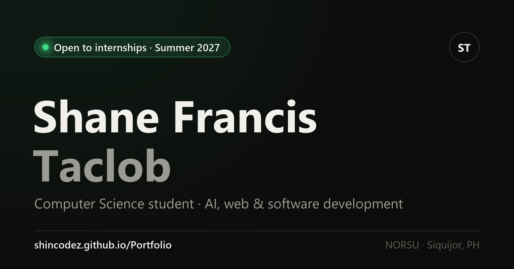

# Portfolio

Personal portfolio of **Shane Francis B. Taclob**, a Computer Science student at Negros Oriental State University interested in AI, web and software development. Open to internships and OJT from Summer 2027.

**Live site:** https://shincodez.github.io/Portfolio/



## What's inside

- **Projects**: NORSU Campus Marketplace and Shallene’s Printing Shop, each with a screenshot gallery and a link to the live site
- **Stack**: languages, frameworks and tools I use
- **Certificates**: webinar and course certificates, with a viewer and PDF downloads
- **Experience**: a short timeline
- **Contact**: email, LinkedIn and GitHub, plus what I'm looking for in an internship

## Built with

Plain HTML, CSS and JavaScript. No frameworks, no build step and no dependencies apart from the Inter font from Google Fonts.

- Light and dark themes that follow the system setting and remember your choice
- Scroll-reveal animations that are turned off for visitors who prefer reduced motion
- Responsive layout: a fixed sidebar on desktop, a single scrolling column on phones
- Keyboard-accessible certificate and screenshot viewers
- Content stays visible if JavaScript fails to load

## Run locally

Any static file server works. With Python:

```bash
python -m http.server 5510
```

Then open http://localhost:5510.

## Structure

```
index.html      page content
style.css       styles and themes
script.js       animations, theme toggle, viewers
img/            project screenshots and link-preview card
certs/          certificate images and PDFs
certs/thumbs/   small certificate images for the grid
```

## Contact

- Email: shanetaclob9@gmail.com
- LinkedIn: https://www.linkedin.com/in/shanefrancistaclob
- GitHub: https://github.com/shincodez
